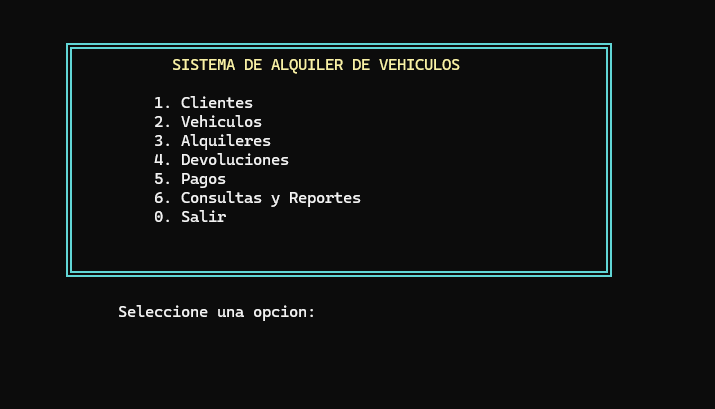
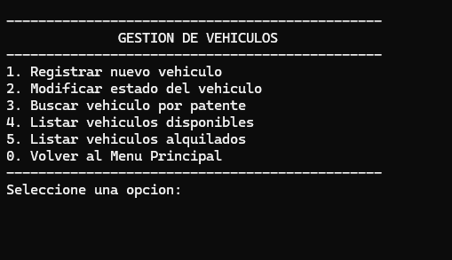
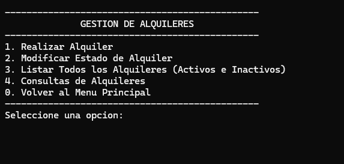

# Sistema de Gestión de Alquiler de Vehículos (TPI PE 2026)


Este repositorio contiene el código fuente del Trabajo Práctico Integrador (TPI) de la materia **Programación Estructurada** (Ciclo Lectivo 2026), correspondiente a la carrera de Ingeniería en Informática de la **Universidad Gastón Dachary** (Sede Campus Urbano — Posadas, Misiones).

El proyecto consiste en una aplicación de consola desarrollada en lenguaje C estándar para la gestión integral de una empresa de alquiler de automóviles. Permite administrar el parque automotor, el padrón de clientes, los contratos de alquiler, las devoluciones con cálculo de mora o reintegros, los cobros y el libro diario contable.

---

## 📜 Descripción del Proyecto

El objetivo de este software es digitalizar y automatizar la operativa de una empresa rentadora de vehículos. El sistema permite registrar clientes, administrar los estados de la flota automotor, emitir contratos con cobro de seña obligatoria, registrar devoluciones efectivas calculando atrasos o entregas anticipadas y asentar las transacciones económicas en cuentas individuales y generales.

El programa opera bajo un modelo de **persistencia directa sobre almacenamiento secundario**: todos los datos maestros y transaccionales se gestionan mediante archivos binarios (`.dat`), prescindiendo de arreglos estáticos globales en memoria RAM y generando archivos de texto plano (`.txt`) para el seguimiento de la cuenta corriente de cada cliente.

### ✨ Funcionalidades principales

El sistema se organiza en torno a un menú interactivo principal que da acceso a seis módulos especializados:

**1. Gestión de Clientes**

- **Registrar Cliente:** alta con validación de DNI de 7 u 8 dígitos, comprobación de duplicados, datos de contacto, domicilio y ficha de confirmación previa antes de escribir en disco.
- **Modificar Estado:** gestión unificada de alta y baja lógica (Activo / Inactivo). Bloquea la desactivación si el cliente posee alquileres vigentes o saldo deudor pendiente.
- **Consultar Cliente (Ficha e Historial):** visualiza los datos del cliente y lee su historial contable desde su archivo individual (`movimientos_<DNI>.txt`).
- **Listar Padrón:** listado completo y tabulado de todos los clientes registrados.

**2. Gestión de Vehículos**

- **Registrar Vehículo:** alta de unidades con validación de patente argentina de 7 caracteres sin espacios (`LLNNNLL`), marca, modelo, año (1990–2026), categoría, capacidad de pasajeros y tarifa diaria.
- **Modificar Estado del Vehículo:** permite alternar entre Disponible, Baja y Mantenimiento. Bloquea la asignación manual del estado Alquilado.
- **Buscar Vehículo por Patente:** consulta la ficha técnica completa y el estado del rodado.
- **Listados Especializados:** listado de flota completa, unidades disponibles para alquiler y reporte de vehículos alquilados con titular, DNI y fechas.

**3. Gestión de Alquileres**

- **Realizar Alquiler:** carga guiada mediante listas de apoyo de clientes activos y vehículos disponibles. Asignación automática de la fecha de inicio mediante `<time.h>`, presupuesto por cantidad de días, cobro de seña obligatoria (mínimo 50% y máximo 100%) y pantalla de confirmación.
- **Modificar Estado de Alquiler:** restringido a la cancelación de contratos activos, liberando inmediatamente la unidad asignada y cambiando su estado a Disponible.
- **Padrón de Alquileres:** listado histórico completo de contratos (Activos, Finalizados y Cancelados).
- **Consultas de Alquileres:** filtros de búsqueda por rango de fechas (2020–2026), cliente (DNI), vehículo (patente), estado operativo o importe.

**4. Gestión de Devoluciones**

- **Registrar Devolución:** captura automática de la fecha real de entrega y cálculo de los días de uso efectivos frente a los pactados.
- **Control de Mora:** si el cliente se atrasa, emite el aviso correspondiente y recalcula el importe total considerando los días adicionales.
- **Devolución Anticipada:** recalcula el precio según los días reales de utilización (mínimo 1 día) y genera un crédito a favor del cliente como reintegro contable.
- **Cobro Obligatorio:** en caso de saldo pendiente, exige cancelar la deuda exacta mediante un ciclo interactivo que rechaza números negativos o montos inexactos. Al liquidar, pasa el contrato a estado Finalizado y libera el vehículo.

**5. Gestión de Pagos**

- **Registrar Pago de Alquiler:** lista exclusivamente los alquileres activos con saldo pendiente real (`> EPSILON`). Impide cobros sobre contratos finalizados o cancelados.
- **Actualización Contable:** actualiza el saldo en `alquileres.dat`, registra el movimiento en `movimientos.dat` y actualiza el archivo de texto individual del cliente.
- **Consultar Movimientos Contables:** muestra el libro diario contable filtrado por DNI, con lista previa de clientes activos.
- **Listar Pagos por Período:** reporte cronológico de recaudación entre dos fechas dentro del rango 2020–2026.

**6. Consultas y Reportes**

- Listados de unidades libres y ocupadas.
- Reporte de clientes con saldo deudor acumulado y total de deuda exigible.
- Panel de estadísticas globales de la empresa:
  - Flota total.
  - Vehículos disponibles.
  - Vehículos alquilados.
  - Contratos cursados.
  - Facturación total.
  - Recaudación real.
  - Montos pendientes de cobro.

---

## 🛠️ Aspectos Técnicos

- **Lenguaje:** C (Estándar ANSI / ISO C99).
- **Paradigma:** Programación Estructurada modular.
- **Principio de Single Return:** cada función implementa un único punto de entrada y un único punto de salida lineal.
- **Cero Variables Globales:** ausencia de variables globales y modificadores `static`. La comunicación se realiza mediante parámetros y valores de retorno, empleando banderas locales.
- **Control de Flujo:** utilización de ciclos `while (!listo)` controlados por condiciones booleanas, evitando bucles infinitos `for (;;)` y saltos `continue`.
- **Persistencia en Disco:** los archivos binarios se recorren registro a registro mediante flujos `FILE *`, utilizando `fread()`, `fwrite()`, `fseek()` y `ftell()`.
- **Modularidad:** el código está organizado en los siguientes archivos:

| Archivo | Descripción |
|---|---|
| `structs.h` | Definición de estructuras de datos (`Fecha`, `Direccion`, `Cliente`, `Vehiculo`, `Alquiler`, `Movimiento`) y constantes simbólicas. |
| `funciones.h` | Prototipos e implementación de la interfaz de consola, validaciones, operaciones de negocio y persistencia. |
| `main.c` | Punto de entrada formal que invoca a `menuPrincipal()` y devuelve 0. |
| `generar_datos.c` | Programa utilitario independiente para inicializar y verificar las bases de datos con casos de prueba completos. |

- **Interfaz:** visualización de consola adaptada para Windows mediante `windows.h`, utilizando funciones como `gotoxy`, `setColor`, `Sleep` y `system("cls")`. Incluye marcos ASCII de doble línea, barras de progreso porcentual y spinners de transición.

---

## ⚙️ Requisitos Previos

- Sistema operativo Windows 10 u 11 (recomendado para la visualización de marcos de doble línea y funciones de consola de `windows.h`).
- Compilador de C compatible con C99, como MinGW/GCC, Clang o MSVC.
- Entorno de desarrollo recomendado: Embarcadero Dev-C++ o Microsoft Visual Studio.

---

## 🚀 Cómo Compilar y Ejecutar

### Opción 1: Embarcadero Dev-C++ (Recomendado)

1. Abrir Dev-C++.
2. Crear un nuevo proyecto desde **Archivo → Nuevo → Proyecto**.
3. Seleccionar **Console Application**, marcar la opción **C Project** y asignar un nombre al proyecto.
4. Copiar los archivos `main.c`, `funciones.h` y `structs.h` en la carpeta del proyecto.
5. Reemplazar el código del archivo `main.c` generado por el código del proyecto.
6. Presionar **F11** o seleccionar **Ejecutar → Compilar y Ejecutar**.

### Opción 2: Microsoft Visual Studio

1. Abrir Visual Studio y seleccionar **Crear un proyecto → Aplicación de consola (C++)**.
2. En el Explorador de soluciones, renombrar el archivo principal `.cpp` a `main.c`.
3. Agregar `funciones.h` y `structs.h` mediante **Agregar → Elemento existente**.
4. Ingresar en **Propiedades del proyecto → C/C++ → Preprocesador**.
5. Añadir la siguiente definición en **Definiciones del preprocesador**:

   ```plaintext
   _CRT_SECURE_NO_WARNINGS
   ```

6. Presionar **Ctrl + F5** para compilar y ejecutar.

---

## 📋 Archivos Generados por el Sistema

El programa administra automáticamente los siguientes archivos en la misma carpeta del ejecutable:

| Archivo | Descripción |
|---|---|
| `clientes.dat` | Almacena los registros de clientes: DNI, nombre, contacto, domicilio y estado. |
| `vehiculos.dat` | Contiene los datos de la flota automotor: patente, marca, modelo, capacidad, tarifa diaria y estado. |
| `alquileres.dat` | Almacena los contratos de alquiler, fechas, importes y estados operativos. |
| `movimientos.dat` | Contiene el libro diario contable: ingresos por señas, liquidaciones de saldos, ajustes y devoluciones. |
| `movimientos_<DNI>.txt` | Archivo individual de texto generado para cada cliente con su historial cronológico detallado. |

---

## 📸 Capturas de Pantalla

A continuación, se presentan las capturas de los diferentes módulos que componen la interfaz del sistema.

### Menú Principal



### Gestión de Clientes


### Gestión de Vehículos



### Gestión de Alquileres



### Gestión de Devoluciones


### Gestión de Pagos


### Consultas y Reportes


---

## 👨‍💻 Autores

Este proyecto fue desarrollado por:

- **Alvarenga, Mariano Ezequiel** — Matrícula: 67908.
- **Martinez, Mariana Priscila** — Matrícula: 67869.
- **Moreno, Francisco** — Matrícula: 67617.
- **Scheuermann, Renata** — Matrícula: 67613.

### Equipo Docente

- **Prof. Titular:** Mg. Ing. Karina B. Eckert.
- **Docente Adjunta:** Ing. Gabriela Barros.
- **Docente Auxiliar:** Ing. Lucas Miguel Rodoni.

---

## 📄 Licencia

Este proyecto se distribuye bajo la **Licencia MIT**, con propósitos académicos y de aprendizaje.
